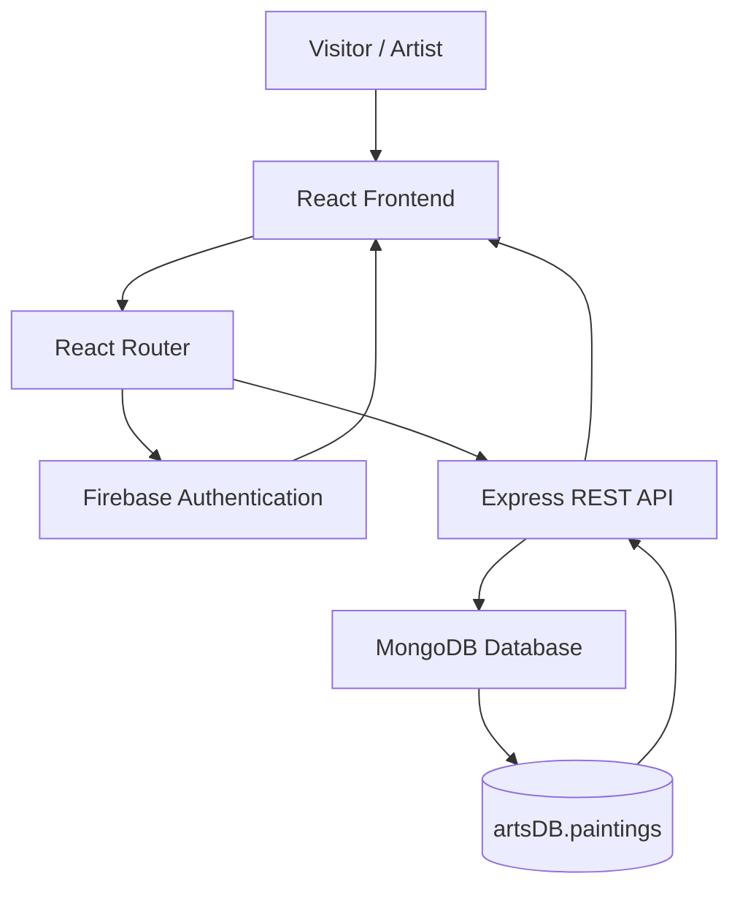
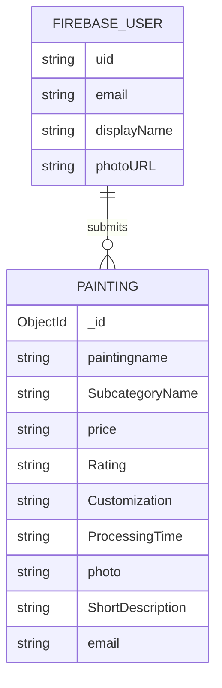
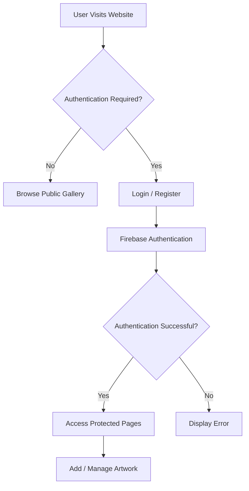
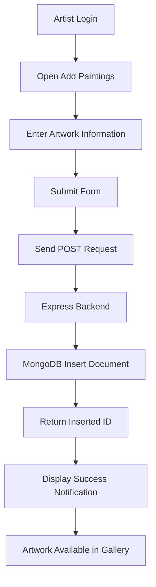
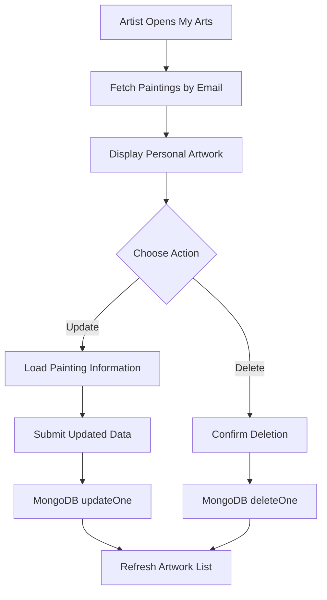

# 🎨 ArtisanHaven – Art & Painting Exhibition Platform
🌐 Live Demo: https://incomparable-parfait-957e61.netlify.app/

ArtisanHaven is a full-stack web application designed to showcase and manage creative artwork. It provides a digital gallery where visitors can explore paintings, while registered artists can submit, update, and manage their own artwork.

The platform combines a React-based frontend, Firebase Authentication, an Express.js backend, and MongoDB for storing painting information.

## 🔗 Project Repositories

- **Frontend:** [Arts Painting Website Client](https://github.com/Shafaet1074/Arts-painting-website-client)
- **Backend:** [Arts Painting Website Server](https://github.com/Shafaet1074/Arts-painting-website-server)

## ✨ Major Features

### Public Gallery
- Explore a collection of paintings.
- View featured artwork on the homepage.
- Browse the complete painting collection.
- View painting details, including price, category, rating, and description.
- Responsive gallery interface with animated visual elements.

### Artist Authentication
- Register using email and password.
- Login using email and password.
- Google and GitHub social authentication.
- Update artist profile information.
- Protected routes for authenticated users.

### Artwork Management
- Submit new paintings to the exhibition.
- Add painting name, category, price, rating, and description.
- Provide artwork image URLs.
- Specify customization availability and processing time.
- View paintings submitted by the logged-in artist.
- Update existing artwork information.
- Delete submitted paintings.
- Filter personal artwork based on customization availability.

### User Interface
- Responsive design for different screen sizes.
- Light and dark theme support.
- Animated sections and transitions.
- Image sliders and interactive artwork cards.
- Toast notifications and confirmation dialogs.

## 🎯 Project Objectives

- Build a digital platform for showcasing artistic creations.
- Provide artists with an accessible way to exhibit their work.
- Simplify artwork submission and management.
- Organize painting information in a centralized database.
- Provide a responsive and visually engaging gallery experience.
- Implement authentication and protected application routes.

## 🛠️ Technology Stack

| Category | Technologies |
|---|---|
| Frontend | React.js 18, Vite |
| Styling | Tailwind CSS, DaisyUI |
| Routing | React Router DOM |
| Authentication | Firebase Authentication |
| Backend | Node.js, Express.js |
| Database | MongoDB |
| Database Driver | MongoDB Native Driver |
| Animations | React Awesome Reveal |
| Slider | Swiper.js |
| Notifications | React Toastify, SweetAlert2 |
| Icons | React Icons |
| Deployment | Firebase Hosting, Vercel |

## 🏗️ System Architecture

The application follows a client-server architecture. React handles the user interface, Firebase manages authentication, and the Express backend communicates with MongoDB.



## 🗄️ NoSQL Database Design

ArtisanHaven uses **MongoDB** as its database. The backend connects to a MongoDB database named `artsDB` and uses a collection named `paintings`.

Unlike a relational SQL database, MongoDB stores information as flexible JSON-like documents.

### Database Overview

| Database | Collection | Purpose |
|---|---|---|
| `artsDB` | `paintings` | Stores artwork details and artist ownership information |

### Paintings Collection

Each painting is stored as an individual MongoDB document.

| Field | Data Type | Description |
|---|---|---|
| `_id` | ObjectId | Unique document identifier |
| `paintingname` | String | Name of the painting |
| `SubcategoryName` | String | Painting category or artistic medium |
| `price` | String | Artwork price |
| `Rating` | String | Initial artwork rating |
| `Customization` | String | Whether customization is available (Yes/No) |
| `ProcessingTime` | String | Estimated processing or shipping time |
| `photo` | String | Artwork image URL |
| `ShortDescription` | String | Description of the artwork |
| `email` | String | Email of the artist who submitted the artwork |

> **Note:** The field names and types above reflect the application code. Most form values are submitted as strings, including price and rating. MongoDB automatically generates `_id` when a document is inserted.

### Sample MongoDB Document

```json
{
  "_id": "MongoDB_ObjectId",
  "paintingname": "Abstract Beauty",
  "SubcategoryName": "Oil Painting",
  "price": "15000",
  "Rating": "4.8",
  "Customization": "Yes",
  "ProcessingTime": "3-5 Business Days",
  "photo": "https://example.com/painting.jpg",
  "ShortDescription": "An expressive abstract artwork.",
  "email": "artist@example.com"
}
```

### Entity Relationship Diagram

The application uses a single MongoDB collection for painting records. Artist accounts are managed separately through Firebase Authentication.

The following diagram represents the logical relationship between an authenticated Firebase user and their painting documents. The relationship is based on the `email` field, not a MongoDB foreign-key constraint.



**Database design observations:**
- Firebase Authentication manages user identity and login credentials.
- MongoDB stores painting information in the `paintings` collection.
- The artist's email is stored in each painting document.
- Multiple painting documents can belong to the same artist.
- The backend uses MongoDB `ObjectId` values to retrieve, update, and delete individual paintings.

## 🔄 Application Workflows

### 1. Authentication Workflow



### 2. Artwork Submission Workflow



### 3. Artwork Management Workflow



## 🔌 Backend API Endpoints

The Express.js backend provides the following REST API endpoints:

| Method | Endpoint | Description |
|---|---|---|
| GET | `/` | Check server status |
| GET | `/addpaintings` | Retrieve all paintings |
| POST | `/addpaintings` | Insert a new painting |
| GET | `/addpaintings/:email` | Retrieve paintings by artist email |
| GET | `/allPaintings/:id` | Retrieve a painting by ID |
| GET | `/myArts/:id` | Retrieve a painting for editing |
| PUT | `/myArts/:id` | Update painting information |
| DELETE | `/delete/:id` | Delete a painting |

## 📁 Project Structure

### Frontend

```text
Arts-painting-website-client/
│
├── public/
├── src/
│   ├── Components/
│   │   ├── Login/
│   │   ├── Register/
│   │   ├── PrivateRoute/
│   │   ├── AllPaintings/
│   │   └── UpdateCart/
│   │
│   ├── Firebase/
│   │   ├── FirebaseConfig
│   │   └── FirbeaseProvider/
│   │
│   ├── Layouts/
│   ├── Pages/
│   │   ├── Home/
│   │   ├── All Paintaings/
│   │   ├── AddPaintings/
│   │   └── MyArts/
│   │
│   ├── context/
│   ├── App.jsx
│   └── main.jsx
│
├── package.json
└── vite.config.js
```

### Backend

```text
Arts-painting-website-server/
│
├── index.js
├── package.json
├── package-lock.json
└── vercel.json
```

## 🚀 Installation and Setup

### Prerequisites

- Node.js and npm
- MongoDB Atlas account
- Firebase project

### 1. Clone the Repositories

```bash
git clone https://github.com/Shafaet1074/Arts-painting-website-client.git

git clone https://github.com/Shafaet1074/Arts-painting-website-server.git
```

### 2. Configure the Backend

```bash
cd Arts-painting-website-server
npm install
```

Create a `.env` file in the backend root directory:

```env
DB_USER=your_mongodb_username
DB_PASS=your_mongodb_password
port=5003
```

Start the backend:

```bash
npm start
```

### 3. Configure the Frontend

```bash
cd Arts-painting-website-client
npm install
```

Configure your Firebase project credentials in the Firebase configuration file.

Start the frontend development server:

```bash
npm run dev
```

The Vite development server will normally run at:

```text
http://localhost:5173
```

## 🔐 Security Considerations

- Firebase Authentication is used to manage user accounts.
- Protected frontend routes restrict access to selected pages.
- MongoDB credentials are configured through environment variables.
- Backend authorization should also be implemented to ensure users can only update or delete their own paintings.
- Sensitive credentials should never be committed to GitHub.

## 🔮 Future Improvements

- Implement backend JWT verification and ownership-based authorization.
- Add artwork search, category filtering, and sorting.
- Introduce image uploads using Cloudinary or Firebase Storage.
- Add an artist profile and portfolio page.
- Implement artwork purchasing and order management.
- Add pagination for large painting collections.

## 👨‍💻 Author

**Shafaet Hossain**

GitHub: [Shafaet1074](https://github.com/Shafaet1074)
